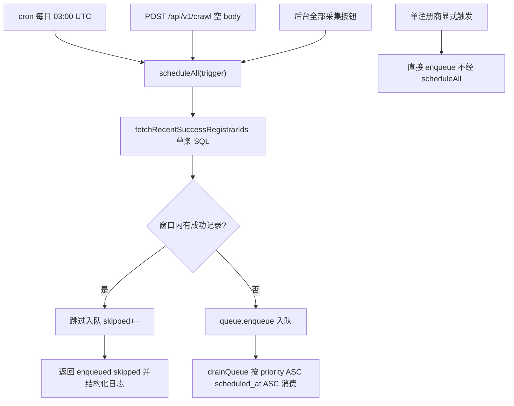

# scheduleAll 入队频率限制

Feature Name: scheduleall-frequency-limit
Updated: 2026-11-04

## Description

为 `scheduleAll` 增加「近期成功跳过」的入队频率限制：频率窗口（默认 6 小时，`CRAWL_SCHEDULE_WINDOW_HOURS` 可配）内有 `crawl_jobs` 成功记录的注册商跳过入队，重复触发聚焦未抓、失败与积压注册商。cron / api / manual 三条批量路径统一受限；后台「全部采集」按钮收编进 `scheduleAll("manual")`；单注册商显式触发路径不经 `scheduleAll`，保持强制入队语义。每日 cron 全量刷新语义保留（窗口 6h < 24h，次日全部注册商窗口外重新入队）。

## Architecture

频率判定数据源为 `crawl_jobs`（source of truth），`registrars.health.lastSuccessAt` 为滞后快照不采用。

## Components and Interfaces

### packages/scheduler/index.ts（修改）

- `getFrequencyWindowMs(): number` — 读取 `CRAWL_SCHEDULE_WINDOW_HOURS`，合法正整数采用，缺省/非法回退 6 小时；值 >= 24 时 `console.warn` 提示每日 cron 全量刷新语义受影响
- `fetchRecentSuccessRegistrarIds(windowMs: number): Promise<Set<number> | null>` — 单条 SQL：
  `SELECT DISTINCT registrar_id FROM crawl_jobs WHERE status = 'success' AND COALESCE(finished_at, created_at) >= NOW() - $1::interval`；查询异常时返回 `null`（降级信号）
- `scheduleAll(trigger: QueueTrigger): Promise<{ enqueued: number; skipped: number }>` — 签名变更：先取近期成功集合（`null` 视为空集合 + warn 日志），遍历激活注册商跳过窗口内成功者，其余入队；返回入队/跳过计数

### app/api/cron/crawl/route.ts（修改）

- 响应由 `{ enqueued, ...drainResult }` 改为 `{ enqueued, skipped, ...drainResult }`

### app/api/v1/crawl/route.ts（修改）

- 全量分支响应携带 `enqueued` 与 `skipped`（当前忽略 scheduleAll 返回值）

### app/actions/admin.ts（修改）

- `triggerCrawlAll` 删除独立 enqueue 循环，改调 `scheduleAll("manual")`；drain 参数（maxJobs=4, budgetMs=12s）与 pendingCount 消息保持不变，消息文案改用 enqueued/skipped 计数

### 不变项

- `DbQueue.enqueue` 去重（pending/retrying 跳过）、`drainQueue` 预算逻辑、`dequeue` 排序（`priority ASC, scheduled_at ASC`）、单注册商触发路径（`/api/v1/crawl` 的 `{registrar}` 分支、`triggerCrawl`）

## Data Models

无 schema 变更。依赖现有表：

- `crawl_jobs(registrar_id, status, finished_at, created_at)` — 频率判定
- `registrars(id, is_active, priority)` — 全量遍历
- `crawl_queue(registrar_id, status, priority, scheduled_at)` — 去重与消费

新增环境变量 `CRAWL_SCHEDULE_WINDOW_HOURS`（Vercel 项目 env，可选；缺省 6）。

## Correctness Properties

1. 同一次 `scheduleAll` 内每家注册商至多入队一项（`enqueue` 去重保证）
2. 频率窗口内成功的注册商在窗口过期前不因重复触发入队
3. 失败、重试、从未采集的注册商每次触发均入队（重试不受频率限制）
4. 频率查询失败时降级为全量入队（可用性优先，调度不中断）
5. 窗口 6h < 24h，次日 cron 执行时全部注册商的成功记录均窗口外，重新全量入队，每日刷新语义保留
6. 单注册商显式触发不经 `scheduleAll`，强制入队语义不变

## Error Handling

| 场景 | 处理 |
|---|---|
| `crawl_jobs` 频率查询异常 | catch → 近期成功集合视为空 → 全量入队 + `console.warn` |
| `CRAWL_SCHEDULE_WINDOW_HOURS` 非法/缺失 | 回退默认 6 小时 |
| 配置值 >= 24 | `console.warn` 提示 cron 刷新语义受影响 |
| `scheduleAll` 返回类型变更 | 两个路由与 admin action 同步适配，TypeScript 编译期保障 |

## Test Strategy

新增 `tests/scheduler-frequency-limit.test.ts`（node:test + tsx --test，与现有 tests/*.test.ts 一致）：

1. `getFrequencyWindowMs`：缺省返回 6h；合法值采用；非法值回退；>=24 触发 warn（spy `console.warn`）
2. 入队分类纯逻辑：构造激活注册商列表与近期成功 id 集合，验证四类行为 —— 窗口内成功跳过、无记录入队、最新失败入队、从未采集入队
3. `fetchRecentSuccessRegistrarIds`：mock `db.execute` 返回行 → Set 正确；抛错 → 返回 `null`
4. 集成验证（生产部署后）：手动全量触发两次，第二次响应 `skipped > 0` 且 `enqueued` 下降；6h 后窗口过期注册商重新入队；cron 与 /api/v1/crawl 响应均含 `enqueued`/`skipped`
5. 回归：`{registrar: slug}` 单家触发直接入队不受限；后台「全部采集」按钮经 `scheduleAll("manual")` 生效

## Implementation Plan

1. `packages/scheduler/index.ts`：频率窗口解析 + 近期成功查询 + 跳过逻辑 + 返回类型变更
2. `app/api/cron/crawl/route.ts`、`app/api/v1/crawl/route.ts`、`app/actions/admin.ts` 适配
3. `tests/scheduler-frequency-limit.test.ts` 单元测试
4. `npx tsc --noEmit` + `npx eslint` + `pnpm test` 本地验证
5. 分支 → PR → squash 合并 → Vercel 生产部署 → 手动全量触发两次验证 skipped 计数

## References

[^1]: (Filename#L19) - packages/scheduler/index.ts:19-36 现有 scheduleAll 全量入队实现
[^2]: (Filename#L70) - packages/queue/index.ts:70-96 DbQueue.enqueue pending/retrying 去重
[^3]: (Filename#L19) - app/api/cron/crawl/route.ts:19 cron 调用点（budgetMs=280s）
[^4]: (Filename#L49) - app/api/v1/crawl/route.ts:48-50 API 全量触发调用点
[^5]: (Filename#L111) - app/actions/admin.ts:111-138 triggerCrawlAll 独立入队循环（收编对象）
[^6]: (Filename#L35) - lib/db/schema.ts:35-56 registrars 表（priority/health 字段）
[^7]: 生产实证 2026-11-04：120 分钟窗口 213 成功任务 / 34 家循环注册商 ≈ 6.3 次重复；61 家 priority>=60 积压挨饿 8 轮
